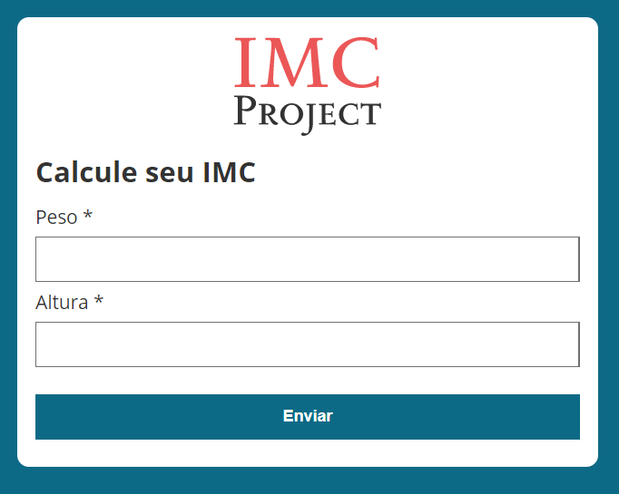

  

 
  
  
  
  

 <a href="#computer-sobre">Sobre</a> •
 <a href="#memo-roteiro">Roteiro</a> •
 <a href="#movie_camera-demonstração">Demonstração</a> •
 <a href="#hammer-tecnologias">Tecnologias</a> •
 <a href="#boy-autor">Autor</a> •
 <a href="#page_facing_up-licença">Licença</a>

---
## :computer: Sobre

Simples projeto para estudo das linguagens bases HTML5, CSS3 e JavaScript ES6. O cálculo de índice de massa corporal (IMC) utiliza a seguinte fórmula: peso / altura ** 2. O resultado é tabulado pela programação e fornece classificações por níveis.

---
## :memo: **Roteiro**

Clique para Visualizar

|      Estado      |     Plataforma   |     Tarefa    |
|      :---:       |       :---:      |      :---     |
|:heavy_check_mark:|:computer:        |Estrutura da página|
|:heavy_check_mark:|:computer:        |Programação da fórmula|
|:heavy_check_mark:|:computer:        |Verificação de inserções de dados|
|:x:		           |:computer:        |Experiência do usuário aprimorada|

---
## :movie_camera: **Demonstração**

<b> :computer::iphone: WEB RESPONSIVO </b>

  <kbd></kbd>

---
## :hammer: **Tecnologias**

As seguintes ferramentas foram utilizadas na construção do projeto:

|WEB Responsivo								|
|:---:									|
|[HTML5](https://developer.mozilla.org/pt-BR/docs/Web/HTML/HTML5)	|
|[CSS3](https://developer.mozilla.org/pt-BR/docs/Archive/CSS3)		|
|[JavaScript](https://www.ecma-international.org/publications/standards/Ecma-262.htm)|

---
## :boy: **Autor**

<a href="https://github.com/rafaelfachinelli">
 
  
 <b>Rafael Fachinelli</b></a>

Feito com ❤️ por Rafael Fachinelli 👋🏽 Entre em contato!

---
## :page_facing_up: **Licença**

Copyright © 2020 [eNaturalist](https://github.com/rafaelfachinelli). 
Este projeto é licenciado pelo [MIT](./LICENSE).

